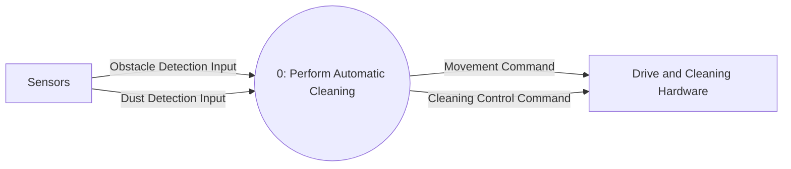

# DFD Level 0

Process 0 represents the complete automatic cleaning function and preserves the Context Diagram's external interface. The Cleaning Control Command now explicitly carries the abstract Normal/Boost power mode. Internal timer state is decomposed at Level 2.

## Balancing

| Context Diagram Flow | DFD Level 0 Flow | Direction |
|---|---|---|
| Obstacle Detection Input | Obstacle Detection Input | Sensors → Process 0 |
| Dust Detection Input | Dust Detection Input | Sensors → Process 0 |
| Movement Command | Movement Command | Process 0 → Drive and Cleaning Hardware |
| Cleaning Control Command | Cleaning Control Command with Normal/Boost mode | Process 0 → Drive and Cleaning Hardware |

No external flow was added for the timer. `Simulation Tick` is an internal temporal event; the boost-state store is shown at Level 2.
