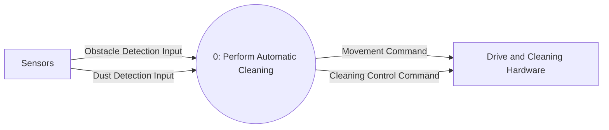

# DFD Level 0

This level represents the whole RVC automatic cleaning function as Process 0. Its external inputs and outputs are balanced with the System Context Diagram.

## Balancing

| Context Diagram Flow | DFD Level 0 Flow | Direction |
|---|---|---|
| Obstacle Detection Input | Obstacle Detection Input | Sensors → Process 0 |
| Dust Detection Input | Dust Detection Input | Sensors → Process 0 |
| Movement Command | Movement Command | Process 0 → Drive and Cleaning Hardware |
| Cleaning Control Command | Cleaning Control Command | Process 0 → Drive and Cleaning Hardware |

No data store or separate control flow is introduced at this level; neither is specified by the preliminary requirements.

