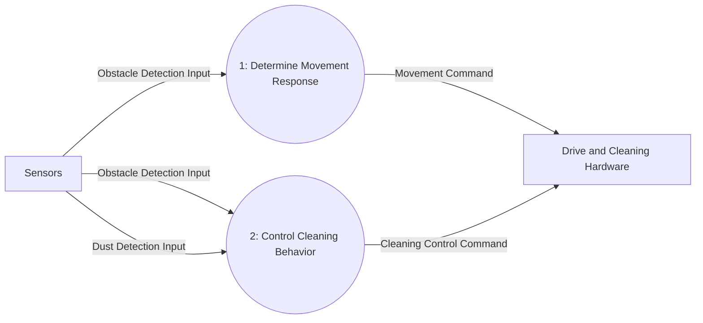

# DFD Level 1

Process 0 is decomposed into movement response and cleaning behavior. The latter maintains the dust boost interval and emits the active power mode. The external input and output flows remain balanced with Level 0.

## Process Decomposition

| Parent Process | Child Process | Responsibility |
|---|---|---|
| 0: Perform Automatic Cleaning | 1: Determine Movement Response | Select forward, turn-aside, or backward movement in response to obstacle detections. |
| 0: Perform Automatic Cleaning | 2: Control Cleaning Behavior | Direct cleaning/mopping, obstacle-related stop/resume behavior, and dust boost state for five simulation ticks. |

## Balancing with Level 0

| Process 0 Interface | Level 1 Flow(s) | Direction |
|---|---|---|
| Obstacle Detection Input | Input to Processes 1 and 2 | Sensors → child processes |
| Dust Detection Input | Input to Process 2 | Sensors → child process |
| Movement Command | Output from Process 1 | Child process → Drive and Cleaning Hardware |
| Cleaning Control Command | Output from Process 2, including Normal/Boost mode | Child process → Drive and Cleaning Hardware |

The Simulation Tick event and timer state are internal to Process 2 and will be decomposed at Level 2; no new external input or output is introduced.
