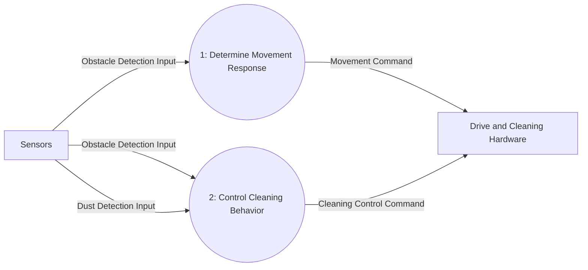

# DFD Level 1

Process 0 is decomposed into movement response and cleaning behavior. Obstacle detections are supplied to both processes because the requirements use obstacle information for movement and for stopping cleaning. The Level 0 external interface is preserved.

## Process Decomposition

| Parent Process | Child Process | Responsibility |
|---|---|---|
| 0: Perform Automatic Cleaning | 1: Determine Movement Response | Select forward, turn-aside, or backward movement in response to obstacle detections. |
| 0: Perform Automatic Cleaning | 2: Control Cleaning Behavior | Direct cleaning/mopping, stop cleaning during obstacle handling, and temporarily increase cleaning power when dust is detected. |

## Balancing with Level 0

| Process 0 Interface | Level 1 Flow(s) | Direction |
|---|---|---|
| Obstacle Detection Input | Obstacle Detection Input to Processes 1 and 2 | Sensors → child processes |
| Dust Detection Input | Dust Detection Input to Process 2 | Sensors → child process |
| Movement Command | Movement Command from Process 1 | Child process → Drive and Cleaning Hardware |
| Cleaning Control Command | Cleaning Control Command from Process 2 | Child process → Drive and Cleaning Hardware |

No internal data flow or data store is introduced. Both external inputs and both external outputs of Process 0 are preserved; the obstacle input is used by both child processes.
