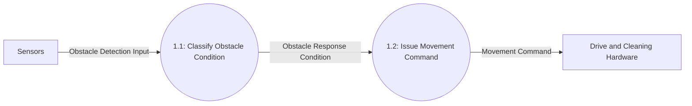
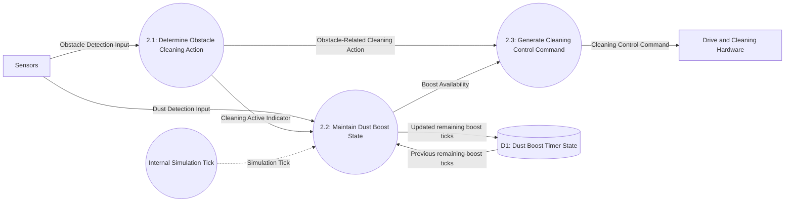

# DFD Level 2

This level decomposes Level 1 Processes 1 and 2. Separate diagrams preserve each parent's external interface. Process 2.2 now maintains the persistent five-tick dust boost state using an internal timer store and temporal tick event.

## Decomposition of Process 1 — Determine Movement Response

| Parent Process | Child Process | Responsibility |
|---|---|---|
| 1: Determine Movement Response | 1.1: Classify Obstacle Condition | Distinguish no obstacle, a partial obstacle condition, and all three specified directions blocked. |
| 1: Determine Movement Response | 1.2: Issue Movement Command | Direct forward, turn-aside, and backward movement according to the classified condition. |

### Balancing with Process 1

| Process 1 Interface | Level 2 Flow(s) | Direction |
|---|---|---|
| Obstacle Detection Input | Obstacle Detection Input to Process 1.1 | Sensors → child process |
| Movement Command | Movement Command from Process 1.2 | Child process → Drive and Cleaning Hardware |

## Decomposition of Process 2 — Control Cleaning Behavior

| Parent Process | Child Process | Responsibility |
|---|---|---|
| 2: Control Cleaning Behavior | 2.1: Determine Obstacle Cleaning Action | Determine whether the current movement action stops or resumes cleaning. |
| 2: Control Cleaning Behavior | 2.2: Maintain Dust Boost State | Start or refresh a five-tick interval on dust detection; advance it on each simulation tick; report remaining boost availability. |
| 2: Control Cleaning Behavior | 2.3: Generate Cleaning Control Command | Combine cleaning activity with boost availability; report Boost only while cleaning is active. |

### Balancing with Process 2

| Process 2 Interface / State | Level 2 Flow(s) | Direction |
|---|---|---|
| Obstacle Detection Input | Input to Process 2.1 | Sensors → child process |
| Dust Detection Input | Input to Process 2.2 | Sensors → child process |
| Cleaning Active Indicator | Output from Process 2.1 to Process 2.2 | Process 2.1 → Process 2.2 |
| Cleaning Control Command | Output from Process 2.3, with power mode | Child process → Drive and Cleaning Hardware |
| Internal boost state | D1 read/write within Process 2 | Process 2.2 ↔ D1 |
| Simulation Tick | Internal temporal trigger to Process 2.2 | Internal clock → child process |

## Data Store

`D1` contains the remaining boost-interval ticks, in the range 0–5. Dust detected on a tick sets it to 5; another dust-positive tick refreshes it to 5. Without dust, it decreases once on every simulation tick, including while cleaning is stopped. Process 2.3 emits Boost only when D1 is positive and the current action is cleaning; otherwise it emits Normal.

The Level 1 external inputs and outputs remain unchanged; timer state is an internal detail of Process 2.
