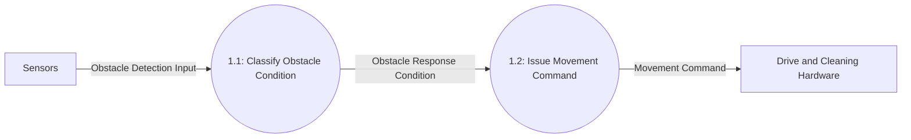
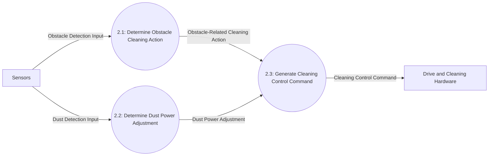

# DFD Level 2

This level decomposes Level 1 Processes 1 and 2 into detailed obstacle and cleaning functions. Separate diagrams are used for each parent process. Each diagram preserves its parent's inputs and outputs.

## Decomposition of Process 1 — Determine Movement Response

| Parent Process | Child Process | Responsibility |
|---|---|---|
| 1: Determine Movement Response | 1.1: Classify Obstacle Condition | Distinguish no obstacle, an obstacle response, and obstacles detected in all three specified directions. |
| 1: Determine Movement Response | 1.2: Issue Movement Command | Direct forward, turn-aside, and backward movement according to the classified condition. |

### Balancing with Process 1

| Process 1 Interface | Level 2 Flow(s) | Direction |
|---|---|---|
| Obstacle Detection Input | Obstacle Detection Input to Process 1.1 | Sensors → child process |
| Movement Command | Movement Command from Process 1.2 | Child process → Drive and Cleaning Hardware |

## Decomposition of Process 2 — Control Cleaning Behavior

| Parent Process | Child Process | Responsibility |
|---|---|---|
| 2: Control Cleaning Behavior | 2.1: Determine Obstacle Cleaning Action | Determine cleaning stop/resume actions stated for obstacle handling. |
| 2: Control Cleaning Behavior | 2.2: Determine Dust Power Adjustment | Request a temporary cleaning power increase when dust is detected. |
| 2: Control Cleaning Behavior | 2.3: Generate Cleaning Control Command | Produce the cleaning/mopping command using the baseline behavior and the obstacle-related and dust-related actions. |

### Balancing with Process 2

| Process 2 Interface | Level 2 Flow(s) | Direction |
|---|---|---|
| Obstacle Detection Input | Obstacle Detection Input to Process 2.1 | Sensors → child process |
| Dust Detection Input | Dust Detection Input to Process 2.2 | Sensors → child process |
| Cleaning Control Command | Cleaning Control Command from Process 2.3 | Child process → Drive and Cleaning Hardware |

The Level 2 external inputs and outputs match the interfaces of Processes 1 and 2 at Level 1. No data stores or separate control flows are introduced because the requirements do not specify them.

