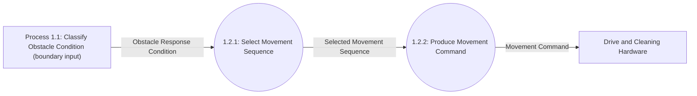
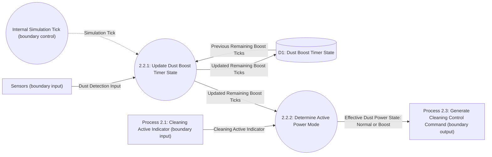

# DFD Level 3

Level 3 decomposes Process 1.2, which selects movement commands, and Process 2.2, which maintains the persistent dust boost interval. Each diagram preserves the corresponding Level 2 process's flows and data-store access.

## Decomposition of Process 1.2 — Issue Movement Command

| Parent Process | Child Process | Responsibility |
|---|---|---|
| 1.2: Issue Movement Command | 1.2.1: Select Movement Sequence | Select the sequence associated with the obstacle response condition. |
| 1.2: Issue Movement Command | 1.2.2: Produce Movement Command | Produce the abstract movement command for the selected sequence. |

### Balancing with Process 1.2

| Process 1.2 Interface | Level 3 Flow(s) | Direction |
|---|---|---|
| Obstacle Response Condition | Input to Process 1.2.1 | Process 1.1 → child process |
| Movement Command | Output from Process 1.2.2 | Child process → Drive and Cleaning Hardware |

## Decomposition of Process 2.2 — Maintain Dust Boost State

| Parent Process | Child Process | Responsibility |
|---|---|---|
| 2.2: Maintain Dust Boost State | 2.2.1: Update Dust Boost Timer State | On a dust-positive tick, set remaining ticks to 5. Otherwise decrement once per tick while positive. Persist the updated count in D1. |
| 2.2: Maintain Dust Boost State | 2.2.2: Determine Active Power Mode | Report Boost only when cleaning is active and updated remaining ticks are positive; otherwise report Normal. |

### Balancing with Process 2.2

| Process 2.2 Interface / State | Level 3 Flow(s) | Direction |
|---|---|---|
| Dust Detection Input | Input to Process 2.2.1 | Sensors → child process |
| Simulation Tick | Internal temporal trigger to Process 2.2.1 | Internal clock → child process |
| Previous/updated boost timer state | Read/write through D1; updated count to Process 2.2.2 | D1 ↔ child process |
| Cleaning Active Indicator | Input to Process 2.2.2 | Process 2.1 → child process |
| Effective Dust Power State | Output from Process 2.2.2 | Child process → Process 2.3 |

The movement diagram preserves Process 1.2's boundary. The timer diagram preserves Process 2.2's sensor, temporal, store, and power-state interfaces. The context-level external flows remain balanced through the unchanged Level 0/1 interfaces.
