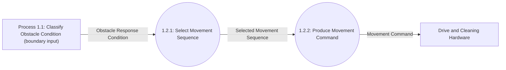

# DFD Level 3

Level 3 further decomposes Process 1.2, whose conditional movement sequences are stated in the requirements. Other Level 2 processes are not decomposed further at this stage.

## Decomposition of Process 1.2 — Issue Movement Command

The rectangular Process 1.1 node marks the input boundary of this decomposition; it is an existing upstream process, not a new external system entity.

| Parent Process | Child Process | Responsibility |
|---|---|---|
| 1.2: Issue Movement Command | 1.2.1: Select Movement Sequence | Select the movement sequence associated with the obstacle response condition. |
| 1.2: Issue Movement Command | 1.2.2: Produce Movement Command | Produce the abstract Movement Command for the selected sequence. |

### Balancing with Process 1.2

| Process 1.2 Interface | Level 3 Flow(s) | Direction |
|---|---|---|
| Obstacle Response Condition | Obstacle Response Condition to Process 1.2.1 | Process 1.1 → child process |
| Movement Command | Movement Command from Process 1.2.2 | Child process → Drive and Cleaning Hardware |

Process 1.1, Processes 2.1–2.3, and all other Level 2 processes remain at their current decomposition. No data store or separate control flow is specified by the requirements.
