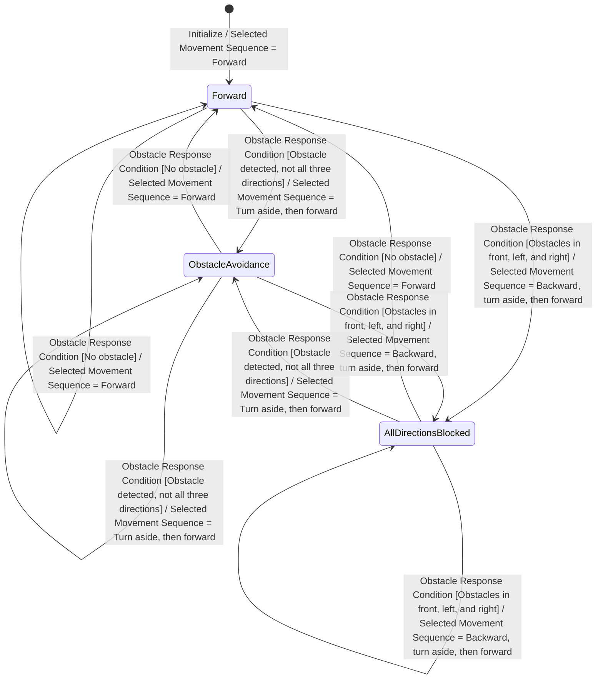

# DFD Level 4 — Controller FSM

## Controller Mapping

This FSM represents Process 1.2.1 — Select Movement Sequence from DFD Level 3. Its input is `Obstacle Response Condition` and its output is `Selected Movement Sequence`. Cleaning control, including dust power adjustment, remains in Processes 2.1–2.3 and is not included in this movement controller FSM.

The states represent the movement sequence selected for the current obstacle condition, not confirmed physical movement progress. The requirements do not define movement completion feedback, sensor sampling timing, or the left/right turn selection rule.

## FSM

## Transition Table

| Current State | Event | Condition | Action | Next State |
|---|---|---|---|---|
| `[*]` | Initialize | Controller enters its initial state | Select forward movement sequence | Forward |
| Forward | Obstacle Response Condition | No obstacle | Selected Movement Sequence = Forward | Forward |
| Forward | Obstacle Response Condition | Obstacle detected, not all three directions | Selected Movement Sequence = Turn aside left or right, then forward | ObstacleAvoidance |
| Forward | Obstacle Response Condition | Obstacles in front, left, and right | Selected Movement Sequence = Backward, turn aside left or right, then forward | AllDirectionsBlocked |
| ObstacleAvoidance | Obstacle Response Condition | No obstacle | Selected Movement Sequence = Forward | Forward |
| ObstacleAvoidance | Obstacle Response Condition | Obstacle detected, not all three directions | Selected Movement Sequence = Turn aside left or right, then forward | ObstacleAvoidance |
| ObstacleAvoidance | Obstacle Response Condition | Obstacles in front, left, and right | Selected Movement Sequence = Backward, turn aside left or right, then forward | AllDirectionsBlocked |
| AllDirectionsBlocked | Obstacle Response Condition | No obstacle | Selected Movement Sequence = Forward | Forward |
| AllDirectionsBlocked | Obstacle Response Condition | Obstacle detected, not all three directions | Selected Movement Sequence = Turn aside left or right, then forward | ObstacleAvoidance |
| AllDirectionsBlocked | Obstacle Response Condition | Obstacles in front, left, and right | Selected Movement Sequence = Backward, turn aside left or right, then forward | AllDirectionsBlocked |

## Validation and Unspecified Behavior

- Each condition is mutually exclusive: no obstacle, obstacle detected but not in all three directions, or obstacles in all three specified directions.
- Every state has a transition for each condition, so no transition priority is needed and no state is unreachable.
- Left/right turn selection is unspecified by the preliminary requirements; the FSM preserves both alternatives.
- The FSM selects abstract movement sequences. It does not model actuator completion or timing because those inputs are not specified in DFD Level 3 or the preliminary requirements.
- The system's cleaning behavior and dust boost are handled by the separate cleaning processes, so simultaneous obstacle/dust priority is not defined by this FSM.
- The initial arrow initializes the FSM to the required forward movement selection; it does not define an external start event or a cleaning command.

## Requirement Traceability

- Preliminary requirement 2: forward movement while cleaning.
- Preliminary requirement 3: turn aside left or right and continue forward when an obstacle is detected.
- Preliminary requirement 4: move backward, turn aside left or right, and then forward when the front, left, and right are blocked.
- DFD Level 3 Process 1.2.1: maps `Obstacle Response Condition` to `Selected Movement Sequence`.
