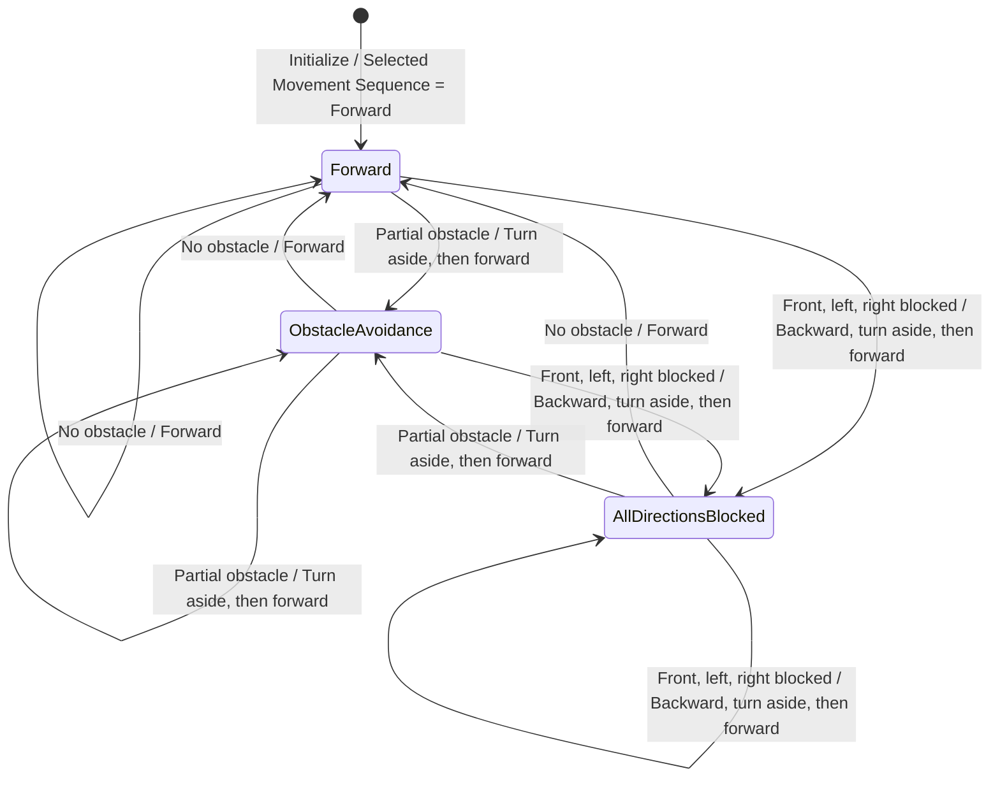
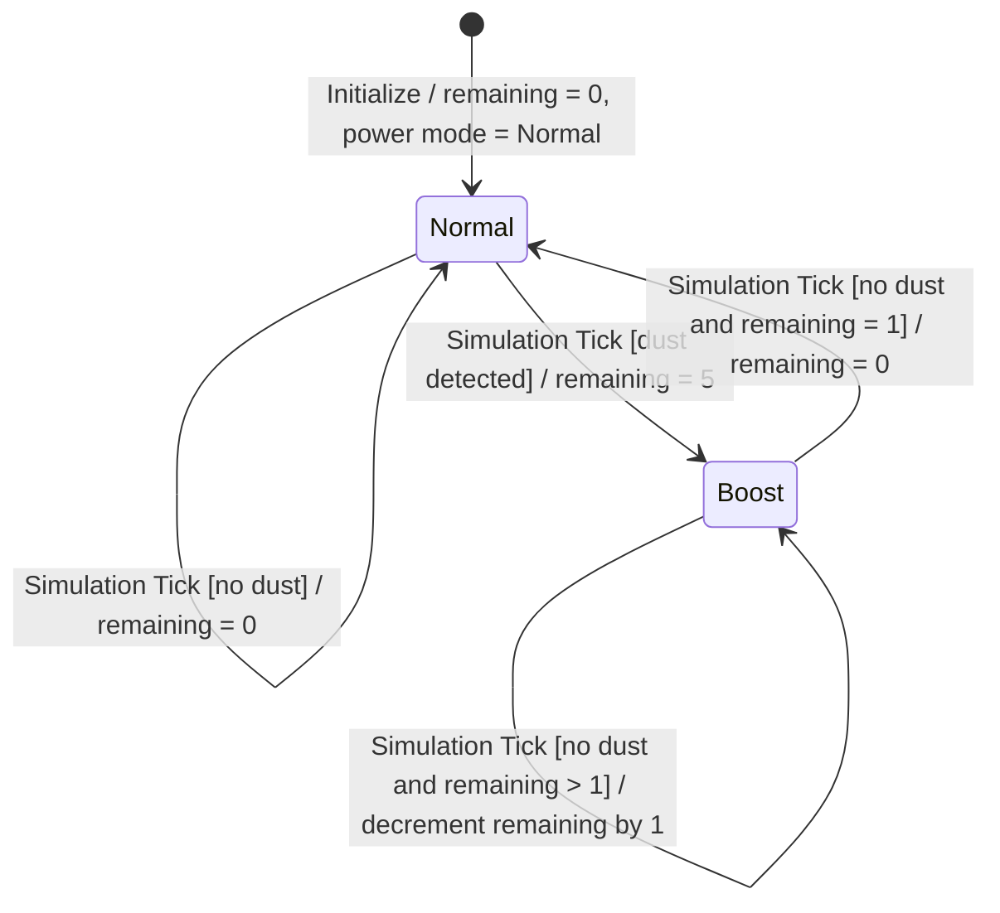

# DFD Level 4 — Controller FSMs

This level contains the Movement FSM and the five-tick Dust Boost Interval FSM. The timer advances once on every simulation tick, independently of movement-sequence progress and cleaning activity. Effective power output is gated by the current cleaning action: stopped cleaning always emits Normal, even while the interval remains active.

## Movement Controller FSM

States represent the response selected for the current obstacle detections, not confirmed physical movement completion. The requirements still leave the left/right selection rule unspecified.

## Dust Boost Interval FSM and Effective Power Output

The dust-positive tick starts a five-tick interval. A subsequent dust-positive tick resets the interval to five. The effective output is Boost only when cleaning is active and the interval has time remaining; during stopped-cleaning actions it is Normal. After five interval ticks without refresh, the timer expires. Numeric actuator power levels remain unspecified and outside the hardware-control scope.

## Requirement Traceability

- RVC-02–RVC-04: Movement Controller FSM and Process 1.2.1.
- RVC-05: Dust Boost Interval FSM, Processes 2.2.1–2.2.2, and D1 Dust Boost Timer State; effective output is gated by cleaning activity.
- RVC-05 timer expiry is deterministic: a dust-positive tick initializes/refreshes to five; each later dust-negative simulation tick decrements once; zero selects Normal.
