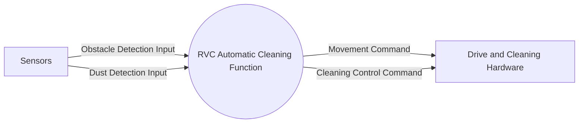

# System Context Diagram

The system boundary covers the RVC automatic cleaning function. Sensor hardware supplies obstacle and dust detections; drive and cleaning hardware receives abstract movement and cleaning commands. Detailed hardware control is outside the stated scope.

## Requirement Ambiguities

- The requirements do not define how or when automatic cleaning starts, so no start input event is shown.
- Sensor and actuator interfaces are not specified. The diagram treats them as external entities and shows only abstract data and commands, consistent with the stated exclusion of detailed hardware control.
- The requirements say cleaning stops when an obstacle is detected, but do not fully specify whether cleaning remains stopped during every avoidance maneuver. The Cleaning Control Command summarizes the stated stop and cleaning behaviors without defining additional timing.

