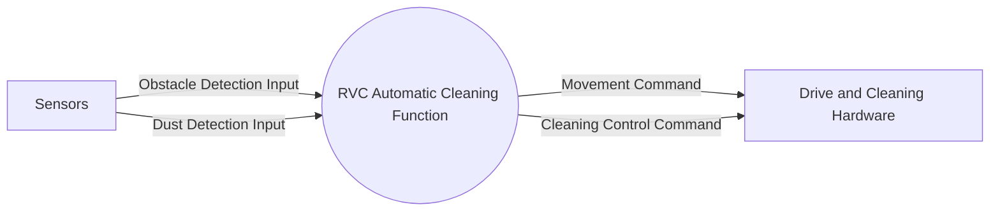

# System Context Diagram

The system boundary covers the RVC automatic cleaning function. Sensor hardware supplies obstacle and dust detections; drive and cleaning hardware receives abstract movement and cleaning commands. The clarified dust boost is represented in the existing Cleaning Control Command as a Normal/Boost power mode. Detailed hardware controls remain outside scope.

## Context Flow Balancing

| External Entity | Flow | Direction | Requirements |
|---|---|---|---|
| Sensors | Obstacle Detection Input | Into system | RVC-03, RVC-04 |
| Sensors | Dust Detection Input | Into system | RVC-05 |
| Drive and Cleaning Hardware | Movement Command | Out of system | RVC-02–RVC-04 |
| Drive and Cleaning Hardware | Cleaning Control Command | Out of system | RVC-01, RVC-03, RVC-05 |

`Simulation Tick` is an internal temporal event in the controller/simulator execution model, so it does not add an external entity or alter the Context Diagram boundary.
