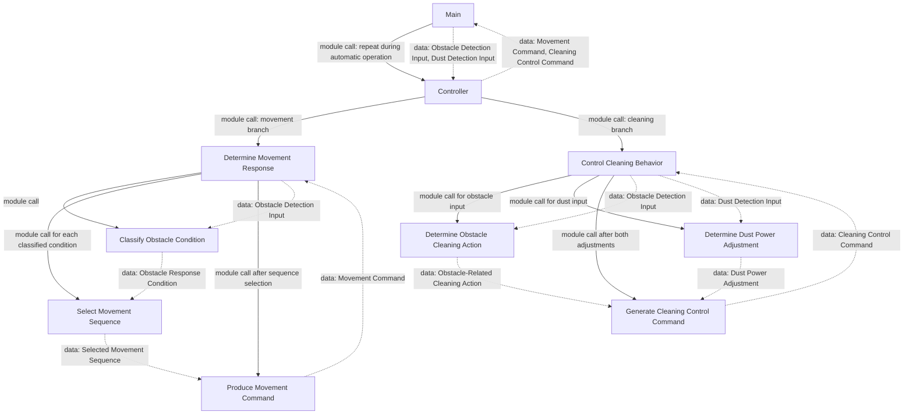

# Structure Chart

## 1. Objective

Represent the C module hierarchy derived from Transform Analysis and the approved SA decomposition.

## 2. Notation

- Solid arrow: module call.
- Dotted arrow: data information passed or returned between modules.
- No separate control-information flow is shown because the SA DFDs define no control flows.
- `Main` calls `Controller` repeatedly while automatic cleaning operates; the start condition and call interval are unspecified.

## 3. Module Hierarchy

The Movement Response and Control Cleaning Behavior branches are independent calls under Controller. Their relative execution order, sensor synchronization, and priority when obstacle and dust events coincide are unspecified. The module calls are not DFD data flows; the dotted arrows show only data coupling.

## 4. Module Descriptions

| Module | Responsibility | Called Modules |
|---|---|---|
| Main | C entry point; invokes Controller during automatic operation. | Controller |
| Controller | Coordinates movement response and cleaning behavior using the supplied sensor inputs and returns abstract output commands. | Determine Movement Response; Control Cleaning Behavior |
| Determine Movement Response | Coordinates obstacle classification, movement sequence selection, and movement command production. | Classify Obstacle Condition; Select Movement Sequence; Produce Movement Command |
| Classify Obstacle Condition | Classifies front, left, and right obstacle detections into the conditions defined in SA. | None |
| Select Movement Sequence | Selects the movement sequence for the obstacle condition, following the Level 4 FSM. Left/right choice remains unspecified. | None |
| Produce Movement Command | Produces the abstract movement command for Drive and Cleaning Hardware from the selected sequence. | None |
| Control Cleaning Behavior | Coordinates obstacle-related cleaning actions, dust power adjustment, and cleaning command generation. | Determine Obstacle Cleaning Action; Determine Dust Power Adjustment; Generate Cleaning Control Command |
| Determine Obstacle Cleaning Action | Determines the cleaning stop/resume action from obstacle detections. | None |
| Determine Dust Power Adjustment | Requests a temporary power increase when dust is detected. | None |
| Generate Cleaning Control Command | Produces the abstract cleaning/mopping command from the obstacle action and dust adjustment. | None |

The chart keeps low-level sensor and actuator drivers outside the modules because detailed hardware controls are explicitly out of scope. Module interfaces use abstract SA inputs and commands.

## 5. Module Interfaces

| Caller | Callee | Input Data | Output Data | Control Information |
|---|---|---|---|---|
| Main | Controller | Obstacle Detection Input; Dust Detection Input | Movement Command; Cleaning Control Command | Repeated invocation during automatic operation; start condition and interval TBD |
| Controller | Determine Movement Response | Obstacle Detection Input | Movement Command | Called as part of automatic operation; exact ordering relative to cleaning branch TBD |
| Controller | Control Cleaning Behavior | Obstacle Detection Input; Dust Detection Input | Cleaning Control Command | Called as part of automatic operation; simultaneous-event priority TBD |
| Determine Movement Response | Classify Obstacle Condition | Obstacle Detection Input | Obstacle Response Condition | One classification per received input; sampling interval TBD |
| Determine Movement Response | Select Movement Sequence | Obstacle Response Condition | Selected Movement Sequence | Select according to the condition and FSM |
| Determine Movement Response | Produce Movement Command | Selected Movement Sequence | Movement Command | Called after a sequence is selected |
| Control Cleaning Behavior | Determine Obstacle Cleaning Action | Obstacle Detection Input | Obstacle-Related Cleaning Action | Called when applying obstacle-related cleaning behavior |
| Control Cleaning Behavior | Determine Dust Power Adjustment | Dust Detection Input | Dust Power Adjustment | Called when applying dust-related behavior |
| Control Cleaning Behavior | Generate Cleaning Control Command | Obstacle-Related Cleaning Action; Dust Power Adjustment | Cleaning Control Command | Called after both derived values are available; update synchronization TBD |

No separate control data is defined by SA. Conditional behavior is encapsulated in Select Movement Sequence, Determine Obstacle Cleaning Action, and Determine Dust Power Adjustment.

## 6. SA-to-SD Traceability

| SA Process ID | SA Process Name | SD Module | Design Rationale |
|---|---|---|---|
| 0 | Perform Automatic Cleaning | Controller | Coordinates the system-level behavior. |
| 1 | Determine Movement Response | Determine Movement Response | Groups the movement-related child processes. |
| 1.1 | Classify Obstacle Condition | Classify Obstacle Condition | Preserves the SA input classification responsibility. |
| 1.2 | Issue Movement Command | Determine Movement Response | Parent responsibility is implemented by the classifier, selector, and command producer modules. |
| 1.2.1 | Select Movement Sequence | Select Movement Sequence | Implements the Level 4 movement FSM decisions. |
| 1.2.2 | Produce Movement Command | Produce Movement Command | Produces the abstract movement output. |
| 2 | Control Cleaning Behavior | Control Cleaning Behavior | Groups the cleaning-related child processes. |
| 2.1 | Determine Obstacle Cleaning Action | Determine Obstacle Cleaning Action | Preserves obstacle-based cleaning control. |
| 2.2 | Determine Dust Power Adjustment | Determine Dust Power Adjustment | Preserves dust-based temporary power adjustment. |
| 2.3 | Generate Cleaning Control Command | Generate Cleaning Control Command | Produces the abstract cleaning output. |

## 8. Design Validation

- Every SA process is mapped to a module or coordinating module.
- Solid arrows show caller-callee relationships; dotted arrows show data coupling.
- No separate control-information flows are invented; conditional decisions remain within the SA-derived modules.
- Controller behavior matches the Level 4 movement FSM. Cleaning behavior remains separate because the FSM is mapped to Process 1.2.1 only.
- Low-level hardware drivers are omitted in keeping with the stated hardware-control exclusion.
- Unresolved requirements remain open: left/right selection, sensor/update timing, the start condition, obstacle/dust priority, and cleaning state during the all-directions-blocked final forward movement.
