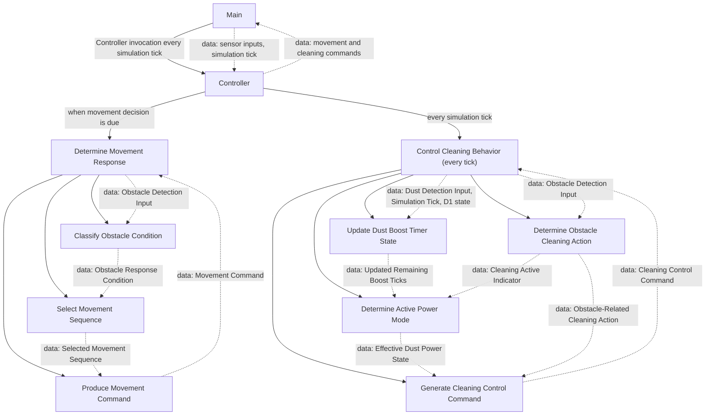

# Structure Chart

## 1. Notation and Design Basis

Solid arrows are module calls. Dotted arrows are data passed/returned. The timer state D1 is private state owned by the Controller, not a module call. Main calls the cleaning tick update on every simulation tick and requests a movement decision when the current movement sequence is consumed.

## 2. Module Hierarchy

## 3. Module Responsibilities and Traceability

| Module | Responsibility | SA Trace |
|---|---|---|
| Main | Supplies sensor snapshots and one Simulation Tick update; requests movement decisions at sequence boundaries. | Structure Chart root; RVC-05 |
| Controller | Owns movement state and D1; coordinates movement and per-tick cleaning behavior. | Process 0 |
| Determine Movement Response | Coordinates obstacle classification, sequence selection, and command production. | Process 1 |
| Classify Obstacle Condition | Classifies front/left/right obstacle detections. | Process 1.1 |
| Select Movement Sequence | Selects the abstract sequence for the classified condition. | Process 1.2.1; Movement FSM |
| Produce Movement Command | Emits the selected movement sequence. | Process 1.2.2 |
| Control Cleaning Behavior | Runs obstacle cleaning actions and boost state update on every tick, then creates the combined command. | Process 2 |
| Determine Obstacle Cleaning Action | Determines the stop/resume action for obstacle behavior. | Process 2.1 |
| Update Dust Boost Timer State | Refreshes to five on dust, otherwise decrements once per tick; owns update access to D1. | Process 2.2.1; D1 |
| Determine Active Power Mode | Derives Boost iff cleaning is active and remaining ticks > 0, else Normal. | Process 2.2.2; Dust Boost Interval FSM |
| Generate Cleaning Control Command | Combines cleaning action and Normal/Boost mode. | Process 2.3 |

## 4. Interfaces

| Caller | Callee | Inputs | Outputs / Return | Invocation |
|---|---|---|---|---|
| Main | Controller | Obstacle Detection Input; Dust Detection Input; Simulation Tick | Movement Command when due; Cleaning Control Command every tick | Each logical simulation tick |
| Controller | Determine Movement Response | Obstacle Detection Input | Movement Command | Only when the prior movement sequence has been consumed |
| Controller | Control Cleaning Behavior | Obstacle Detection Input; Dust Detection Input; Simulation Tick; D1 | Cleaning Control Command | Every tick, including movement-sequence continuation ticks |
| Determine Movement Response | Classify Obstacle Condition | Obstacle Detection Input | Obstacle Response Condition | Per movement decision |
| Determine Movement Response | Select Movement Sequence | Obstacle Response Condition | Selected Movement Sequence | After classification |
| Determine Movement Response | Produce Movement Command | Selected Movement Sequence | Movement Command | After selection |
| Control Cleaning Behavior | Determine Obstacle Cleaning Action | Obstacle Detection Input | Obstacle-Related Cleaning Action | Per tick or applicable obstacle update |
| Control Cleaning Behavior | Update Dust Boost Timer State | Dust Detection Input; Simulation Tick; D1 | Updated Remaining Boost Ticks; updated D1 | Every tick |
| Control Cleaning Behavior | Determine Active Power Mode | Updated Remaining Boost Ticks; Cleaning Active Indicator | Effective Dust Power State | Every tick |
| Control Cleaning Behavior | Generate Cleaning Control Command | Obstacle-Related Cleaning Action; Dust Power State | Cleaning Control Command | After current tick values are available |

Numeric boost level and left/right turn selection are not defined.
