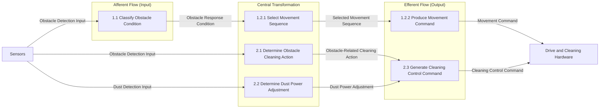

# Transform Analysis

## 1. Objective

Identify the input-processing, decision, and output-generation regions from the SA DFD hierarchy and use those boundaries to derive the module structure.

## 2. Transform Regions

### Afferent Flow (Input)

| Process ID | Process Name | Input | Output |
|---|---|---|---|
| 1.1 | Classify Obstacle Condition | Obstacle Detection Input | Obstacle Response Condition |

Sensor acquisition itself is an external interface in the Context Diagram and DFD, not an internal process; detailed sensor hardware control is outside scope.

### Central Transformation (Process)

| Process ID | Process Name | Input | Output |
|---|---|---|---|
| 1.2.1 | Select Movement Sequence | Obstacle Response Condition | Selected Movement Sequence |
| 2.1 | Determine Obstacle Cleaning Action | Obstacle Detection Input | Obstacle-Related Cleaning Action |
| 2.2 | Determine Dust Power Adjustment | Dust Detection Input | Dust Power Adjustment |

These processes interpret the detected conditions and determine the movement or cleaning response. The movement selection behavior follows the DFD Level 4 FSM.

### Efferent Flow (Output)

| Process ID | Process Name | Input | Output |
|---|---|---|---|
| 1.2.2 | Produce Movement Command | Selected Movement Sequence | Movement Command |
| 2.3 | Generate Cleaning Control Command | Obstacle-Related Cleaning Action, Dust Power Adjustment | Cleaning Control Command |

## 3. Transform Boundaries

- **Afferent-to-Central Boundary:** `Obstacle Response Condition` from Process 1.1 to Process 1.2.1. `Obstacle Detection Input` and `Dust Detection Input` also enter Processes 2.1 and 2.2 directly from the Sensors external entity, as shown in DFD Level 2.
- **Central-to-Efferent Boundary:** `Selected Movement Sequence` from Process 1.2.1 to Process 1.2.2; `Obstacle-Related Cleaning Action` and `Dust Power Adjustment` from Processes 2.1 and 2.2 to Process 2.3.
- **Boundary Data Flows:** Obstacle Detection Input, Dust Detection Input, Obstacle Response Condition, Selected Movement Sequence, Obstacle-Related Cleaning Action, and Dust Power Adjustment.
- **Boundary Control Flows:** None are specified in the SA DFDs.

The two external output flows, `Movement Command` and `Cleaning Control Command`, leave the Efferent region for Drive and Cleaning Hardware. Their low-level hardware implementation is excluded by the preliminary requirements.

## 4. Transform Analysis Diagram

## 5. Analysis Rules

- The regions use the process names and identifiers from DFD Levels 2–3.
- DFD data flows are shown here as analysis flows; they do not define module calls.
- No separate control flow or hardware-control process is added.
- Dust/obstacle priority and the all-directions-blocked cleaning state remain unresolved SA requirements and are not resolved by this analysis.

