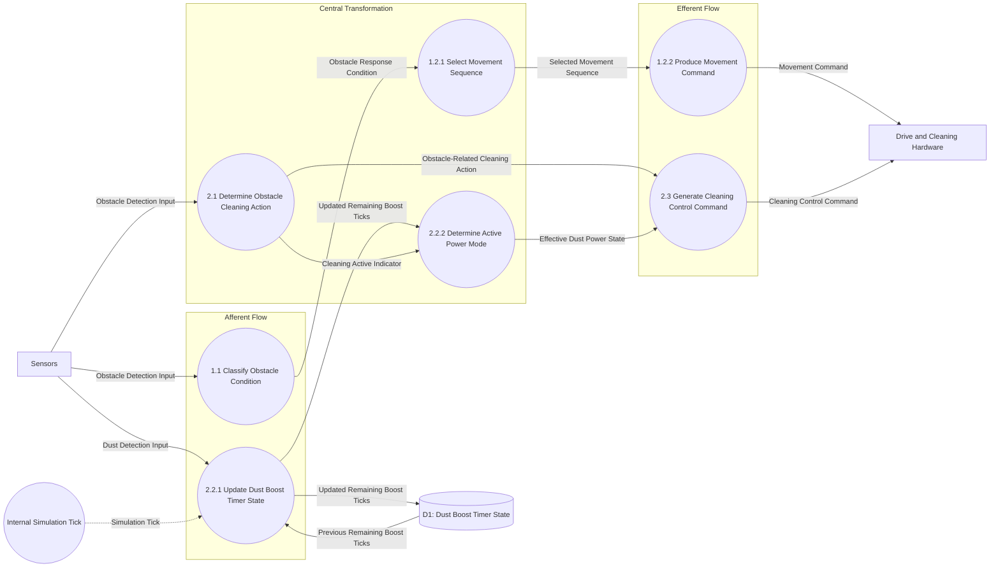

# Transform Analysis

## 1. Objective

Identify input, decision, and output regions from the revised SA, including the timer update that occurs every simulation tick.

## 2. Transform Regions

### Afferent Flow (Input)

| Process | Input | Output |
|---|---|---|
| 1.1 Classify Obstacle Condition | Obstacle Detection Input | Obstacle Response Condition |
| 2.2.1 Update Dust Boost Timer State | Dust Detection Input; Simulation Tick; Previous Remaining Boost Ticks | Updated Remaining Boost Ticks |

### Central Transformation

| Process | Input | Output |
|---|---|---|
| 1.2.1 Select Movement Sequence | Obstacle Response Condition | Selected Movement Sequence |
| 2.1 Determine Obstacle Cleaning Action | Obstacle Detection Input | Obstacle-Related Cleaning Action |
| 2.2.2 Determine Active Power Mode | Updated Remaining Boost Ticks; Cleaning Active Indicator | Effective Dust Power State |

### Efferent Flow (Output)

| Process | Input | Output |
|---|---|---|
| 1.2.2 Produce Movement Command | Selected Movement Sequence | Movement Command |
| 2.3 Generate Cleaning Control Command | Obstacle-Related Cleaning Action; Effective Dust Power State | Cleaning Control Command |

## 3. Transform Boundaries

- Afferent-to-central: sensor inputs and the internal Simulation Tick enter the controller. The Simulation Tick is temporal control information, not a new external hardware flow.
- Central transformations classify/select movement, maintain the boost interval, and derive effective power from cleaning activity and remaining time.
- Central-to-efferent: selected movement sequence and combined cleaning action/power mode become abstract commands.
- D1 stores the transient remaining tick count inside the controller.

## 4. Transform Analysis Diagram

## 5. Analysis Rules

- Process IDs and data flows follow SA DFD Levels 2–3.
- D1 is transient controller state; numeric actuator power remains unspecified.
- Main must advance the timer on every simulation tick, even when no new movement sequence is selected.
- Module calls are defined separately in `structure_chart.md`.
